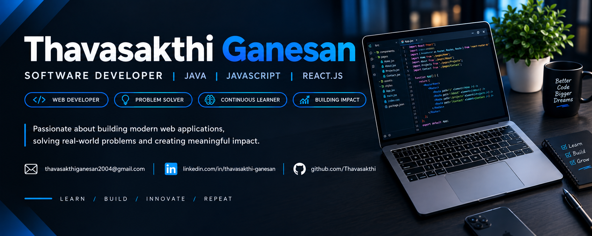

  

  

  

---

## About Me

I'm **Thavasakthi Ganesan**, a **Web Developer** and Computer Science Engineering graduate with hands-on experience in web and software development.

I work with **Java, JavaScript, HTML5, CSS3, React.js, Node.js, REST APIs, and MySQL**, with experience in developing responsive web applications, reusable components, API integration, database operations, testing, and debugging.

I have a strong foundation in **Java, OOP, SQL, DBMS, and software development practices**, with experience using **Git and GitHub** for version control.

Currently seeking an entry-level **Junior Software Developer / Web Developer** opportunity.

---

## Tech Stack

### Technical Skills

* **Languages:** JavaScript, Java, SQL
* **Frontend:** HTML5, CSS3, React.js, Tailwind CSS
* **Backend:** Node.js, REST APIs
* **Database:** MySQL, SQL, Joins
* **Java Technologies:** Maven
* **Testing:** JUnit 5, Unit Testing
* **Tools:** Git, GitHub, VS Code, Postman
* **Core Concepts:** Responsive Web Design, API Integration, OOP, DBMS, Authentication, Debugging

---

## Internship Experience

### Web Development Intern — Magizhini Technology Services

**Jul 2026 – Aug 2026**

* Developed and maintained web application features using modern web technologies.
* Worked on frontend development, API integration, debugging, and application improvements.
* Collaborated with team members on feature development and bug fixing.

---

### Web Development Intern — Tarcin Robotics, Madurai

**Feb 2026 – Jul 2026**

* Developed responsive **React.js components** and integrated REST APIs to build functional web interfaces.
* Performed database operations, application testing, debugging, and performance optimization.
* Collaborated with team members using **Git and GitHub** for source-code management, feature development, testing, and bug fixing.

---

### Frontend Intern — Hazzino Technologies

**Jun 2025 – Jul 2025**

* Developed responsive web pages using **HTML5, CSS3, JavaScript, and MySQL**.
* Tested and debugged web applications to improve functionality and reliability.

---

## Projects

### VeloDrive — Secure File Storage & Collaboration Platform

**React.js · Node.js · Express.js · MongoDB · JWT · 2FA · RBAC · Socket.IO**

* Developed a responsive web interface using **React.js** for secure file upload, storage, and file management.
* Integrated REST APIs and implemented authentication features including **JWT, 2FA, and RBAC**.
* Implemented real-time collaboration using **Socket.IO**.
* Deployed the application using **Vercel and Render**.

---

### Institution Intelligence Engine

**React.js · REST APIs · MongoDB**

* Developed a responsive **React.js interface** for managing and analyzing academic and placement data.
* Integrated REST APIs with **MongoDB** for data retrieval, storage, filtering, and reporting.

---

### AI-Driven Unified Health Care Emergency Intelligence System

**React.js · Node.js · Express.js · MongoDB · Python · Machine Learning**

* Developed an AI-based healthcare system for **emergency detection and intelligent decision-making**.
* Implemented AI/ML techniques to analyze healthcare data and identify critical situations.
* Presented the research paper at the **CTET 2026 National Conference**.

---

## Certifications

* **NPTEL** — Java Programming
* **IBM SkillsBuild** — Web Development Fundamentals
* **Infosys Springboard** — Java for Beginners
* **Cisco Networking Academy** — Networking Basics

---

## Education

### B.E. Computer Science Engineering

**Nadar Saraswathi College of Engineering & Technology, Theni, Tamil Nadu**

**2022 – 2026**

**CGPA: 8.42 / 10**

### Higher Secondary Certificate

**HSC — 87.50%**

**2021 – 2022**

### Secondary School Leaving Certificate

**SSLC — 81.40%**

**2019 – 2020**

---

## Achievements

* **Academic Excellence Award** — Received twice
* **3rd Rank** — Secured in the 3rd and 5th semesters

---

## Conferences & Research Presentations

### AI-Driven Unified Health Care Emergency Intelligence System

Presented research paper at the **One-Day National Conference on Current Trends in Engineering & Technology (CTET 2026)** in **April 2026**.

---

## GitHub Statistics

  

  

---

## Let's Connect

  

**Learn. Build. Innovate. Repeat.**

